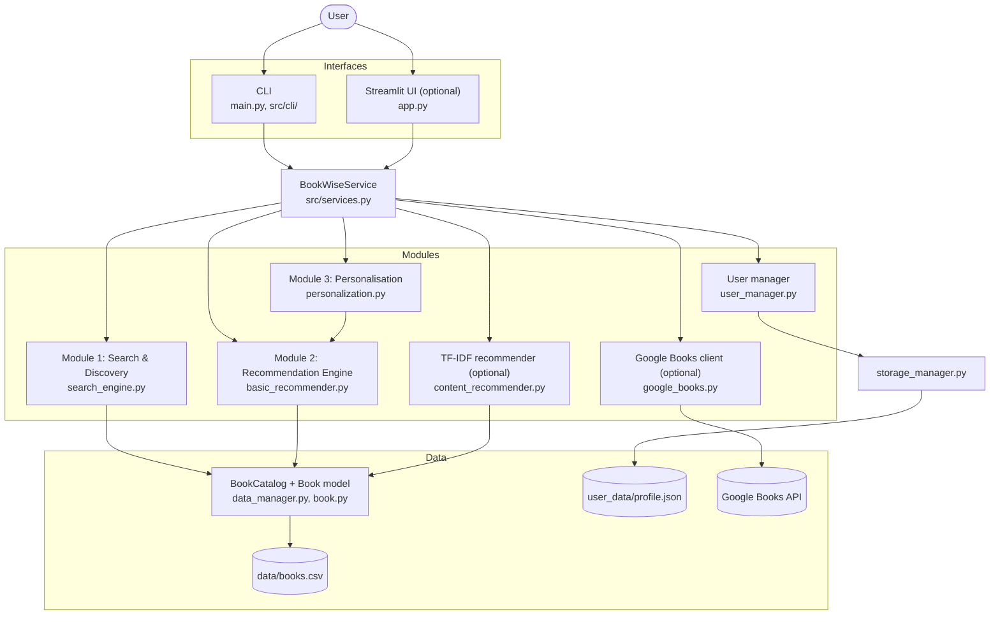
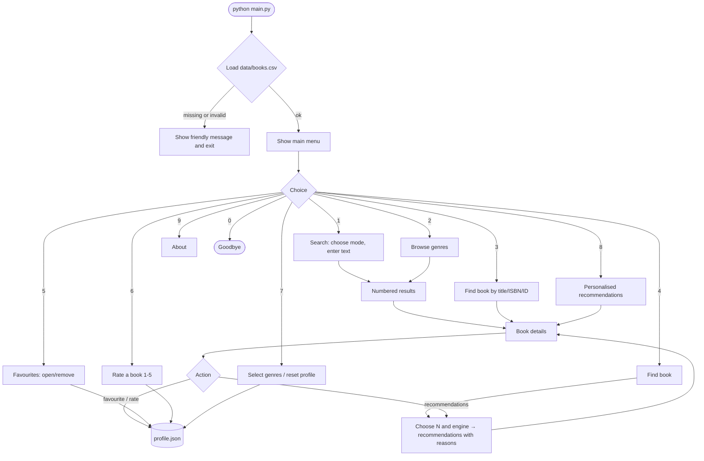
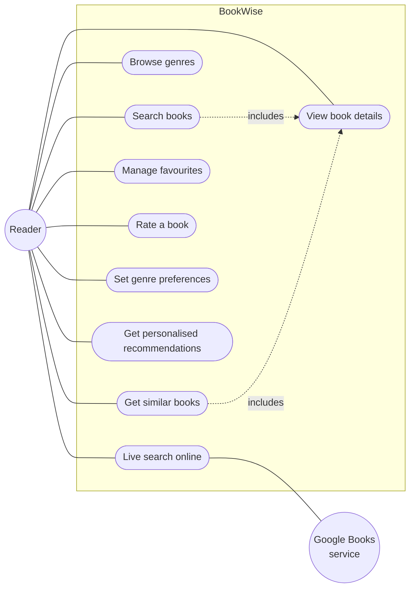
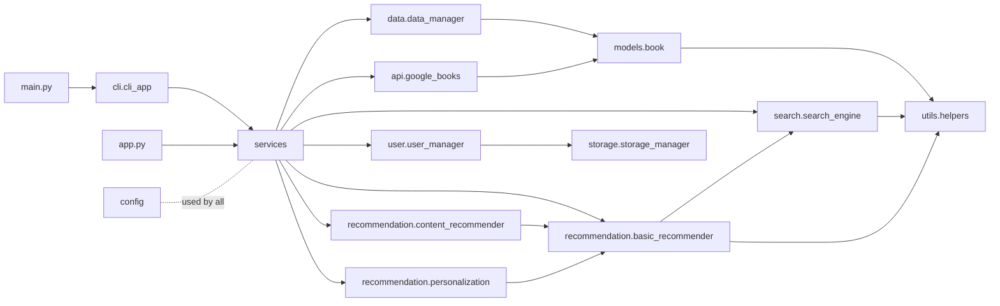
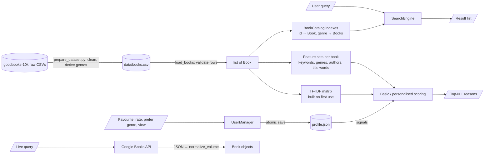

# BookWise — Architecture

## 1. Layers

```
User
 ↓
CLI (main.py → src/cli)   /   Streamlit (app.py, optional)
 ↓
Application service (src/services.py → BookWiseService)
 ↓
Search  /  Recommendation  /  User management
 ↓
Storage (JSON)  /  Dataset (CSV)  /  Google Books API (optional)
```

The main design rule is that **interfaces contain no business logic**. The CLI and
the Streamlit app only read input and show output. Everything else, like searching,
scoring, saving and calling the API, is done by modules that both interfaces share
through `BookWiseService`. So the two interfaces can never behave differently, and
the logic can be tested without typing into menus.

## 2. System architecture diagram



## 3. Component responsibilities

| Component | File | Responsibility |
|---|---|---|
| Entry point | `main.py` | Sets up logging, creates the service, starts the CLI, and turns crashes, Ctrl+C and dataset errors into friendly messages |
| CLI | `src/cli/cli_app.py`, `input_helpers.py` | Menus, numbered lists, paging, input validation |
| Streamlit UI | `app.py` | Optional web pages that call the same service |
| Service | `src/services.py` | One object that loads everything once and exposes every feature as a method; caches the TF-IDF model |
| Configuration | `src/config.py` | Paths, limits, recommendation weights, API settings |
| Book model | `src/models/book.py` | Immutable `Book` dataclass plus display helpers ("Not available") |
| Data manager | `src/data/data_manager.py` | Reads and validates the CSV, converts rows into `Book`s, builds the id and genre indexes (`BookCatalog`) |
| Search engine | `src/search/search_engine.py` | Title, author, genre, ISBN and keyword search with ranking |
| Basic recommender | `src/recommendation/basic_recommender.py` | Weighted set similarity, top-N, duplicate removal, explanations |
| Advanced recommender | `src/recommendation/content_recommender.py` | TF-IDF vectors + cosine similarity, built once |
| Personalisation | `src/recommendation/personalization.py` | Ranks the catalogue for the user's genres, likes, dislikes and history |
| User manager | `src/user/user_manager.py` | Favourites, ratings (validated), genre preferences, history |
| Storage | `src/storage/storage_manager.py` | Atomic JSON save; backs up corrupted files |
| API client | `src/api/google_books.py` | HTTP request, error handling, JSON → `Book` normalisation |
| Helpers | `src/utils/helpers.py` | Text normalisation, tokenising, Jaccard, formatting, logging setup |
| Dataset preparation | `scripts/prepare_dataset.py` | One-time download and cleaning of goodbooks-10k |

## 4. Application workflow



After every option finishes, the program returns to the main menu (the `while True` loop in `BookWiseCLI.run`).

## 5. Use-case diagram

Mermaid has no UML use-case diagram, so a flowchart is used in the same style: the
actor is on the left and the use cases are in the system boundary.



## 6. Module / component diagram (imports)



There are no circular imports. Lower layers (models, helpers, storage) never import
higher layers (services, interfaces).

## 7. Data-flow diagram



## 8. Key design decisions

| Decision | Reason |
|---|---|
| The core uses only the standard library (`csv`, `json`, `re`, `dataclasses`) | It runs anywhere with plain Python, and it shows Python fundamentals instead of hiding them behind libraries |
| CSV for books, JSON for user data (not SQLite) | The book data is read-only and tabular, so CSV fits. The user data is a small nested structure (lists, a dict, a set), which maps directly to JSON. A database would add complexity without a clear benefit at this size |
| `Book` is a frozen dataclass with tuple fields | A single, typed shape for local and API books. Being immutable prevents accidental edits of shared data |
| Features and indexes are computed once | Searching and recommending then only compare pre-built sets |
| TF-IDF is optional and built lazily | The core never depends on scikit-learn. The ~1 s build cost is paid only if the user asks for the advanced engine, and only once |
| One custom exception per failure area (`DatasetError`, `StorageError`, `InvalidRatingError`, `GoogleBooksUnavailable`) | Interfaces catch a small set of clear errors and show friendly text. Technical details go to `logs/bookwise.log` |
| Configuration in one file | Weights and limits can be changed and justified in one place |
